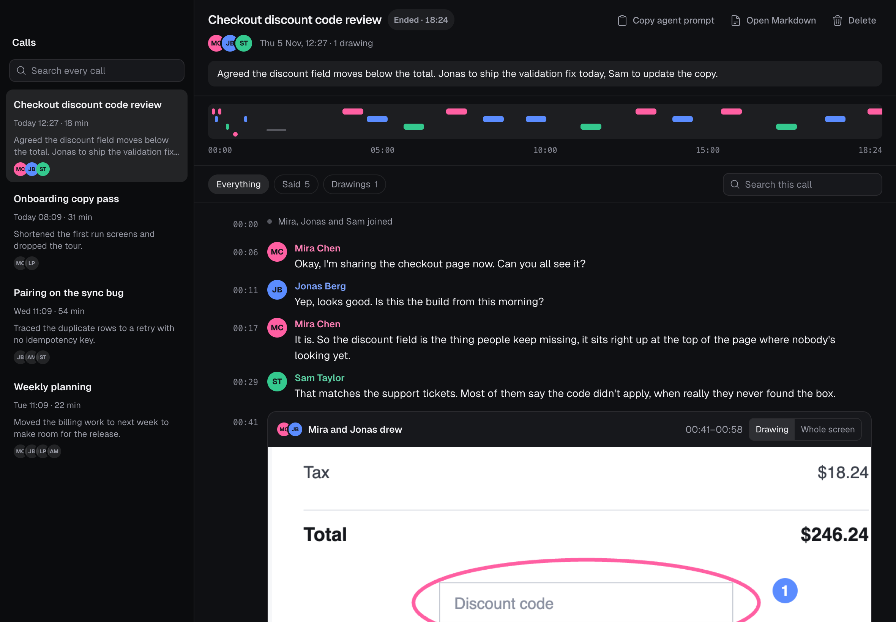
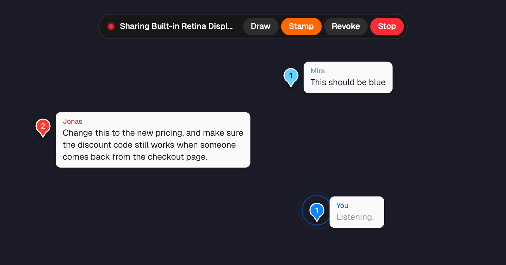
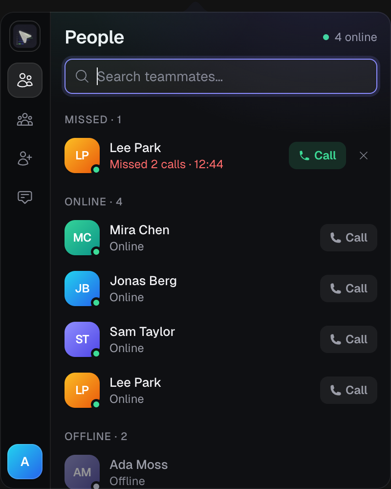

<div align="center">

# Hopp

Open source screen sharing and calls for pair programming, with a searchable transcript of every call that your coding agent can read.

[Install](#install) · [What's new](#whats-new) · [Self-host](#self-host) · [Releases](https://github.com/useforesight/hopp/releases/latest) · [Upstream project](https://github.com/gethopp/hopp)

[](./LICENSE.md)
![Powered by LiveKit](https://img.shields.io/badge/powered-by%20LiveKit-blue.svg?labelColor=212121&logo=data:image/svg%2bxml;base64,PHN2ZyB3aWR0aD0iMjQiIGhlaWdodD0iMjQiIHZpZXdCb3g9IjAgMCAyNCAyNCIgZmlsbD0ibm9uZSIgeG1sbnM9Imh0dHA6Ly93d3cudzMub3JnLzIwMDAvc3ZnIj4KPGcgY2xpcC1wYXRoPSJ1cmwoI2NsaXAwXzQyODRfMzM1ODUpIj4KPHBhdGggZD0iTTE0LjQwMDQgOS41OTk2MUg5LjU5OTYxVjE0LjQwMDRIMTQuNDAwNFY5LjU5OTYxWiIgZmlsbD0id2hpdGUiLz4KPHBhdGggZD0iTTE5LjIwMTEgNC44MDA3OEgxNC40MDA0VjkuNjAxNTNIMTkuMjAxMVY0LjgwMDc4WiIgZmlsbD0id2hpdGUiLz4KPHBhdGggZD0iTTE5LjIwMTEgMTQuNDAwNEgxNC40MDA0VjE5LjIwMTFIMTkuMjAxMVYxNC40MDA0WiIgZmlsbD0id2hpdGUiLz4KPHBhdGggZD0iTTI0IDBIMTkuMTk5MlY0LjgwMDc1SDI0VjBaIiBmaWxsPSJ3aGl0ZSIvPgo8cGF0aCBkPSJNMjQgMTkuMTk5MkgxOS4xOTkyVjI0SDI0VjE5LjE5OTJaIiBmaWxsPSJ3aGl0ZSIvPgo8cGF0aCBkPSJNNC44MDA3NSAxOS4xOTkyVjE0LjQwMDRWOS41OTk2MlY0LjgwMDc1VjBIMFY0LjgwMDc1VjkuNTk5NjJWMTQuNDAwNFYxOS4xOTkyVjI0SDQuODAwNzVIOS41OTk2M0gxNC40MDA0VjE5LjE5OTJIOS41OTk2M0g0LjgwMDc1WiIgZmlsbD0id2hpdGUiLz4KPC9nPgo8ZGVmcz4KPGNsaXBQYXRoIGlkPSJjbGlwMF80Mjg0XzMzNTg1Ij4KPHJlY3Qgd2lkdGg9IjI0IiBoZWlnaHQ9IjI0IiBmaWxsPSJ3aGl0ZSIvPgo8L2NsaXBQYXRoPgo8L2RlZnM+Cjwvc3ZnPgo=)



</div>

This is a fork of [gethopp/hopp](https://github.com/gethopp/hopp), the open source Tuple alternative. It keeps Hopp's low-latency screen sharing and remote control, and adds calls you can't miss, better drawing, stamps, a dark mode and call transcripts.

The screenshots use made-up people and calls.

## Install

On a Mac, paste this into Terminal. It quits Hopp, installs the latest release and reopens it:

```bash
curl -fsSL https://raw.githubusercontent.com/useforesight/hopp/main/install.sh | bash
```

Hopp updates itself after that. macOS asks for Hopp's permissions the first time.

Builds are self-signed and not notarized by Apple. The script checks the signature for you. If you use a DMG from [Releases](https://github.com/useforesight/hopp/releases/latest) instead, macOS blocks it the first time: go to System Settings > Privacy & Security and choose Open Anyway.

| Platform | Status |
| --- | --- |
| macOS | Stable, Apple Silicon and Intel |
| Windows | Alpha, from [Releases](https://github.com/useforesight/hopp/releases/latest). No captures. |
| Linux | A separate native client for Omarchy and Hyprland, built from source: see [`linux-client/`](./linux-client/README.md) |

Release builds connect to `pair.gethopp.app`, upstream's managed service, until you choose another server. To use your own, follow the link on the sign-in screen, or see [Self-host](#self-host).

## What's new

### In the latest release (v1.3.2)

- **Statuses stay true.** Starting or joining a call sets an Away you chose back to Available, and someone on a call no longer shows as Away. Do not disturb stays as it is.
- **No more phantom calls.** Someone left alone in a one-to-one call no longer shows as "In a call", and your server closes such calls after 10 minutes once it runs this release's backend.
- **Transcription stays on the GPU.** The transcription helper no longer restarts itself after going quiet.

### Earlier, in v1.3.1

- **Dropped calls are handled.** If you join a call from somewhere else, such as a browser, Hopp leaves it on your Mac and offers to rejoin there. If a call is closed, Hopp leaves it and says why. If the connection drops for good, Hopp rejoins by itself.
- **Empty calls end.** A call with someone ends once you've been alone in it for 5 minutes, so your mic doesn't stay live. Rooms stay open.
- **Captures recover.** A capture whose Markdown copy couldn't be saved, for example because the disk was full, gets it back once your next capture finishes.

### Earlier, in v1.3.0

- **Available, Away and Do not disturb.** Set your status from the account menu, and teammates see it before they call. Away still rings. Do not disturb doesn't: the caller is told, and it goes in your missed calls. Hopp sets you to Away when your screen locks or you've been idle a while, and back when you return. Your server needs this release's backend for statuses to appear.
- **Quieter speaker indicators.** A small slot beside each name shows who's speaking or muted.

### Earlier, in v1.2.0

Captures and the `hopp` command are in the Mac app. Windows doesn't have them.

**Captures.** A transcript of each call, one track per person, transcribed and saved on your own computer. It keeps pictures of what was drawn and shown too. Right-click the capture button in the call window to read them, search them or follow one live.

> [!IMPORTANT]
> Capture is on by default, so every call is transcribed unless you turn it off in Settings > Capture. The first call downloads a 731 MB speech model. People on older versions of Hopp see no sign that you're capturing, so tell them.

**Stamps.** Hold down on a spot on the shared screen and say your note, and your words appear on the stamp as you speak. Let go and it's stamped once they're written down. If you're muted, holding unmutes you until you let go. Or click a spot and type, then press Enter. Right-click a stamp to remove it, or anywhere else to clear all of yours.



**Coding agents.** `hopp mcp` gives an agent your captures over MCP, including following a live call and waking when someone says "jeepers". Agents can read captures but can't start one.

```bash
hopp capture search "discount code"       # search every call
hopp capture follow --on-wake             # wait until someone says "jeepers"
hopp ask --title "Ship this?"             # show a card, and exit 0 if they accept
```

Settings > Capture has the MCP setup to copy, and the command to put `hopp` on your `PATH`.

**Also new:** drawings that stay until you clear them, a sharing toolbar with Draw, Stamp, Revoke and Stop, a colour for each person on the call, and call controls that stay usable when the camera window is very small.

### Earlier, in v1.1.0



- **Calls you can't miss.** An incoming call stays on screen until you answer or decline it. Missed calls stay too, as a card, a badge on the menu bar icon and a Missed section in People.
- **Calls that recover.** A stalled mic, speaker or camera restarts by itself, and if the call engine crashes it rejoins the call.
- **Better drawing.** Smooth strokes that show up on light and dark screens. Hold Shift for a straight line, press Cmd+Z to undo, and right-click to clear.
- **A new look.** Every window is redesigned, with Auto, Light and Dark modes.
- **Keyboard first.** Open People, type a name and press Return to call. There's also a [Raycast extension](./raycast/README.md).
- **Fewer surprise shortcuts.** Only the mic shortcut is on by default. Turn the others on in Settings.

<br clear="right" />

## Self-host

```bash
git clone https://github.com/useforesight/hopp.git
cd hopp/selfhost
cp .env.example .env   # edit DOMAIN + secrets
docker compose up -d   # for localhost see the full guide in selfhost/README.md
```

Includes Postgres, Redis, LiveKit and Caddy auto-TLS. Full guide: [`selfhost/README.md`](./selfhost/README.md).

## Repo map

| Path | What |
| --- | --- |
| `tauri/` | Desktop app (Tauri, React and TypeScript) |
| `core/` | Screen capture and WebRTC engine (Rust, `hopp_core`) |
| `crates/` | Shared Rust: marks and stamps, captures and the `hopp` command, the transcription helper |
| `linux-client/` | Native client for Omarchy and Hyprland (Rust and GPUI) |
| `backend/` | API server (Go, Postgres and Redis) |
| `web-app/` | Web dashboard (React and Vite) |
| `raycast/` | Raycast extension for calling teammates |
| `selfhost/` | Docker Compose self-host stack |
| `livekit-local-server/` | Dev LiveKit config |
| `docs/` | Upstream's documentation site |

## Documentation

- [Core process docs](./core/README.md)
- [Captures and the `hopp` command](./crates/hopp-capture/README.md)
- [Releasing](./RELEASING.md)
- [Upstream docs](https://docs.gethopp.app) cover the basics of Hopp, but not what this fork adds.

## Credits

Hopp is built by the team at [gethopp](https://github.com/gethopp/hopp), who also run a [managed service](https://gethopp.app), with WebRTC infrastructure from [LiveKit](https://livekit.io).

Licensed under [LICENSE.md](./LICENSE.md).
